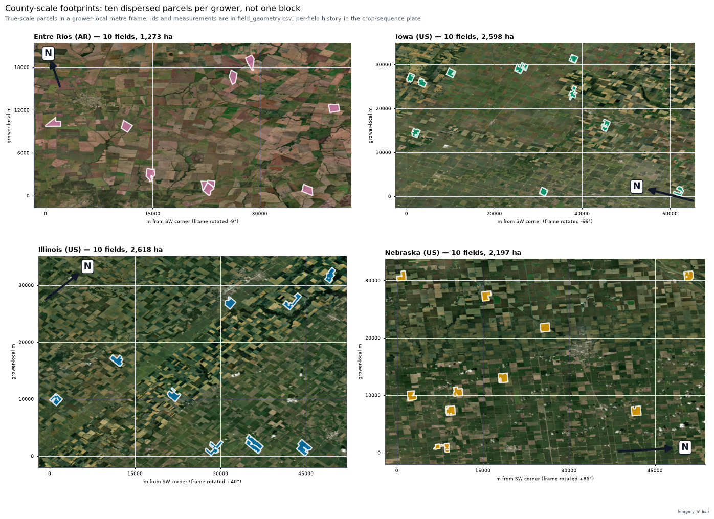
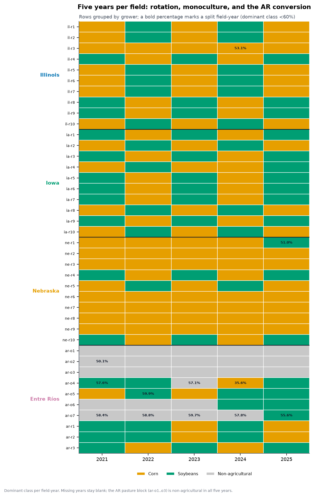

# Field-Comparison EDA (boundaries · cropland · weather)

Field-level exploratory analysis across **growers**. For a runtime with several
growers, this subskill answers the questions that decide whether field-level data can
be treated as independent observations: are the fields comparable, does the rotation
differ, and is the weather actually different from field to field?

Output is static — PNG figures, CSV tables, a `manifest.json`, and a one-page
`cross_grower_summary.csv`. No dashboard, no report. Report assembly is a separate
one-time step layered on top of these artifacts.

- Method contract, thresholds, and the story behind each figure: [`GUIDE.md`](GUIDE.md)
- Local editing rules and invariants: [`AGENTS.md`](AGENTS.md)
- Routing entry: [`../INDEX.md`](../INDEX.md)
- The one-time Assignment 2 report assembled from these artifacts:
  [`../field-comparison-report.html`](../field-comparison-report.html)

## Gallery

| | |
| --- | --- |
|  |  |
| Ten county-scale parcels per grower, at true scale over Esri World Imagery. The parcels are **dispersed**, 500 m-5 km apart over a 20-60 km span — not one contiguous block. | Each of the 40 fields × 2021-2025, coloured by dominant CDL/MNC class, with split field-years annotated. Corn–soy alternation in IL/IA, corn-heavy NE, and the Argentine pasture-to-soy conversion. |

Both examples are regenerated from the Assignment 2 runtime and reviewed against the
five-point figure gate in [`CONTRIBUTING.md`](../../../CONTRIBUTING.md). They are
demonstration fixtures only — regenerate for any other runtime.

## What it produces

| Category | Statistical views | Comparison / correlation | Map |
| --- | --- | --- | --- |
| Boundaries | field size distribution; compactness vs area | Kruskal-Wallis + pairwise Mann-Whitney (Holm) + Spearman size-vs-shape | 01 boundaries |
| Cropland | 100 % stacked composition by grower-year; field × year sequence | grower × class and grower × change chi-square, rotation descriptors | 02 latest crop |
| Weather | annual precip per series; monthly temperature climatology | pairwise series correlation + independence audit | 03 weather series |

Nine figures, twelve tables, one manifest. `cross_grower_summary.csv` puts area,
rotation style, split-field years, weather-series count, and precipitation/GDD ranges
side by side for the four growers — usually the first file to open.

## Run it

```bash
export DATA_PIPELINE_DATA_ROOT=~/my-farm-advisor-runtime
"${DATA_PIPELINE_DATA_ROOT}/data-pipeline/.venv/bin/python" \
  my-farm-advisor/data-pipeline/src/scripts/eda/run_field_comparison.py \
  --out /tmp/field-eda
```

Writes under `<runtime>/data-pipeline/eda/field-comparison` by default. `--growers`
restricts the run, `--no-maps` skips the tile-backed plates, `--no-figures` writes
tables only.

## The two rules that keep the numbers honest

1. **Weather repeats per field.** Ten fields sharing one grid cell write ten identical
   daily series. The CLI hashes each field's values into distinct series and drops
   duplicate series-days **before** summing — otherwise annual precipitation and GDD
   are inflated ten-fold. On the Assignment 2 runtime, 40 fields collapse to 10 series
   (AR 1, NE 2, IA 3, IL 4); the weather plate makes that visible, the audit table
   states it, and the AR within-grower comparison is null by construction.
2. **Crop class comes from the crop map.** CDL for the US, MNC for Argentina. The
   boundary `crop` attribute is a human/OSM hint (Argentina's says `"Unknown"`) and is
   never used as evidence.

Everything else — split threshold, GDD definition, geodesic measurement, why the
p-values are descriptive, and why there is no scale bar — is in [`GUIDE.md`](GUIDE.md).

## Dependencies

- Runtime libraries (not vendored): `lib/field_frame.py`, `lib/basemap.py` for the map
  plates, reached through `reporting_bootstrap.ensure_skill_path`.
- `soil/cdl-cropland/src/cdl_reporting.py` for the non-crop class vocabulary.
- `pandas`, `numpy`, `scipy`, `geopandas`, `pyproj`, `matplotlib`, `rasterio`
  (already in the runtime virtualenv).

Written in-repo for the Assignment 2 dataset expansion; reuses pipeline libraries
rather than copying them.
